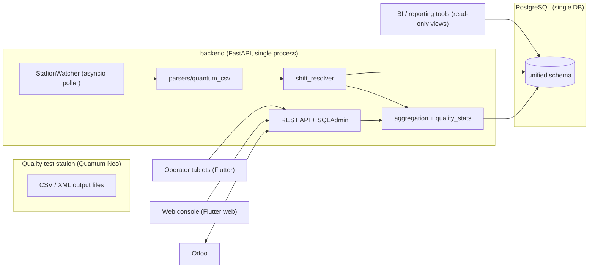

# mes_pft — Cigarette Filter MES (Manufacturing Execution System)

A single unified backend + frontend for a cigarette filter manufacturing facility.

> **History:** the codebase merged two earlier systems — `production_api` (FastAPI +
> PostgreSQL, shift reporting on tablets) and `Data_Bridge` (Tkinter + watchdog + SQLite,
> quality test-station ingestion) into one `backend/app`. The legacy `/api/*` routes are
> kept unchanged for compatibility with old tablet APKs; new development uses `/api/v2`.

The unifying aggregate is the **Shift** (`shift_sessions`), uniquely identified by
`(machine_id, started_at, ended_at)`. Incoming station measurements are
automatically linked to the open shift on that machine, and the shift-close report
now includes shift-level quality aggregations (mean, sample/population standard
deviation, min/max, pass/fail) for the critical parameters.

## Architecture



## Directory tree

```
mes_pft/
├── backend/
│   ├── app/
│   │   ├── main.py            # FastAPI app + lifespan (workers)
│   │   ├── models.py          # SQLAlchemy models (unified)
│   │   ├── schemas.py  database.py  security_config.py  config.py  seed.py
│   │   ├── quality_stats.py   # pure statistics (tested)
│   │   ├── v2_routes.py       # unified /api/v2 routes
│   │   ├── services/
│   │   │   ├── station_watcher.py    # async polling ingester
│   │   │   ├── shift_resolver.py     # (machine, ts) -> shift/run
│   │   │   ├── aggregation.py        # shift-close + certificate assembly
│   │   │   ├── quarantine.py         # NCR + quarantine ledger
│   │   │   ├── parsers/quantum_csv.py
│   │   │   └── odoo/                 # Odoo XML-RPC client, in/outbound, shadow, recall
│   │   └── scripts/           # dev/admin scripts (create_admin, create_station_key, ...)
│   ├── alembic/              # migrations (alembic.ini, env.py, versions/)
│   ├── scripts/              # dev-only smoke tests (target the DEV Odoo on 8070)
│   ├── tests/                # unittest suite
│   ├── requirements.txt  requirements-dev.txt  Dockerfile  .dockerignore
├── frontend/                 # Flutter app (tablet + web console)
├── docs/                     # architecture, api, data-lifecycle, odoo, changelog, ...
├── scripts/                  # deploy/maintain scripts (install_server, update_server, ...)
├── docker-compose.yml
├── .env.example
├── ROADMAP.md
└── README.md
```

## Quickstart (local development)

```bash
cd backend
python -m venv .venv && .venv/bin/activate      # Windows: .venv\Scripts\activate
pip install -r requirements-dev.txt

# create .env from the root template, then run:
cp ../.env.example .env   # edit values

uvicorn app.main:app --reload --port 8001
```

> The **development** MES server runs on port **8001** (production runs on 8000).
> The development Odoo instance runs on port **8070** (see `docs/odoo-integration.md`).

Run the test suite:

```bash
cd backend
python -m unittest discover -s tests -t .
```

## Quickstart (Docker)

```bash
cp .env.example .env   # edit DB_USER, DB_PASSWORD, DB_NAME, SECRET_KEY
docker compose --env-file .env up -d --build
```

## Environment variables

See `.env.example` for the full, commented reference. Key variables:

| Variable | Purpose |
|---|---|
| `ENV` | `production` enables strict checks (refuses placeholder secrets/admin) |
| `DB_USER` / `DB_PASSWORD` / `DB_HOST` / `DB_PORT` / `DB_NAME` | PostgreSQL connection |
| `SECRET_KEY` | Signs bearer tokens + SQLAdmin cookies |
| `STATION_WATCH_PATH` / `STATION_WATCH_PATHS` | Legacy static fallback folders — Pull folders are configured in **Settings → Quality Stations** (`station_profiles.watch_path`) |
| `STATION_SCAN_INTERVAL` | Watcher poll interval in seconds (default `30`) |
| `STATION_MACHINE_ALIAS_FIELD` | Station column identifying the machine (`maker`) |
| `STATION_MO_FIELD` | Station column carrying the MO number (`batch_description` / `comments` / `brand`) |
| `WEB_BUILD_DIR` | Flutter web build directory (defaults to `frontend/build/web`) |
| `ODOO_ENABLED` / `ODOO_URL` / `ODOO_DB` / `ODOO_USER` / `ODOO_API_KEY` | Odoo ERP connector (XML-RPC). Production Odoo runs on `8069`; the **dev** Odoo runs on **8070** |
| `ODOO_WEBHOOK_SECRET` | HMAC secret for the Odoo → MES webhooks (`mo-event`, `mo-recall`) |
| `ODOO_SHADOW_MODE` | Rehearse Odoo writes without applying them (`true` during trial) |

## Documentation

- `docs/architecture.md` — shift resolution, data lifecycle, quality-statistics methodology.
- `docs/api.md` — endpoint documentation (`/shifts`, `/measurements`, `/quality-summary`).
- `docs/data-lifecycle.md` — from Quantum Neo output to PostgreSQL, BI/reporting views, and Odoo sync.
- `docs/odoo-integration.md` — Odoo connector, QC field mapping, UoM conversion, outbox.
- `docs/station-agent.md` — station push agent + pull watcher setup.
- `docs/AUTHENTICATION.md` — bearer tokens, password policy, client integration.
- `docs/SECURITY_NOTES.md` — security posture and incident history.
- `docs/CHANGELOG.md` — release history. `docs/mes-roadmap-ideas.md` — review notes and decisions.
- `ROADMAP.md` (root) — technical debt and open questions.

## Security

See `docs/SECURITY_NOTES.md`. Secrets must never be committed (`.gitignore` +
`.dockerignore` cover `.env`, keystores, tokens). Rotate anything that was ever
shared outside the machine.
