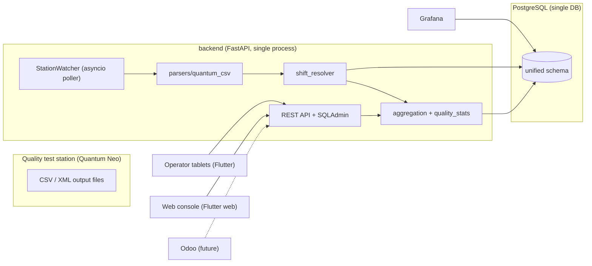

# mes_pft — Cigarette Filter MES (Manufacturing Execution System)

A single unified backend + frontend for a cigarette filter manufacturing facility.
It merges two previously independent systems:

| Was | Now |
|---|---|
| `production_api` (FastAPI, PostgreSQL) — shift reporting on tablets | `backend/app` — the single backend |
| `Data_Bridge` (Tkinter + watchdog + SQLite) — quality test-station ingestion | `backend/app/services` — integrated async ingester |

The unifying aggregate is the **Shift** (`shift_sessions`), uniquely identified by
`(machine_id, started_at, ended_at)`. Incoming station measurements are
automatically linked to the open shift on that machine, and the shift-close report
now includes shift-level quality aggregations (mean, sample/population standard
deviation, min/max, pass/fail) for the critical parameters.

## Architecture



## Directory tree

```
mes_pft/
├── backend/
│   ├── app/
│   │   ├── main.py            # FastAPI app + lifespan (workers)
│   │   ├── models.py          # SQLAlchemy models (unified)
│   │   ├── schemas.py  database.py  security_config.py  config.py  seed.py
│   │   ├── quality_stats.py   # pure statistics (tested)
│   │   ├── services/
│   │   │   ├── station_watcher.py    # async polling ingester
│   │   │   ├── shift_resolver.py     # (machine, ts) -> shift/run
│   │   │   ├── aggregation.py        # shift-close + certificate assembly
│   │   │   └── parsers/quantum_csv.py
│   │   └── scripts/create_admin.py
│   ├── alembic/              # migrations (alembic.ini, env.py, versions/)
│   ├── tests/                # unittest suite
│   ├── requirements.txt  requirements-dev.txt  Dockerfile  .dockerignore
├── frontend/                 # Flutter app (tablet + web console)
├── docs/                     # architecture, api, data-lifecycle
├── docker-compose.yml
├── .env.example
└── README.md
```

## Quickstart (local development)

```bash
cd backend
python -m venv .venv && .venv/bin/activate      # Windows: .venv\Scripts\activate
pip install -r requirements-dev.txt

# create .env from the root template, then run:
cp ../.env.example .env   # edit values

uvicorn app.main:app --reload --port 8000
```

Run the test suite:

```bash
cd backend
python -m unittest discover -s tests -t .
```

## Quickstart (Docker)

```bash
cp .env.example .env   # edit DB_USER, DB_PASSWORD, DB_NAME, SECRET_KEY
docker compose --env-file .env up -d --build
```

## Environment variables

See `.env.example` for the full, commented reference. Key variables:

| Variable | Purpose |
|---|---|
| `ENV` | `production` enables strict checks (refuses placeholder secrets/admin) |
| `DB_USER` / `DB_PASSWORD` / `DB_HOST` / `DB_PORT` / `DB_NAME` | PostgreSQL connection |
| `SECRET_KEY` | Signs bearer tokens + SQLAdmin cookies |
| `STATION_WATCH_PATH` / `STATION_ARCHIVE_PATH` / `STATION_ERROR_PATH` | Station watcher folders |
| `STATION_MACHINE_ALIAS_FIELD` | Station column identifying the machine (`maker`) |
| `WEB_BUILD_DIR` | Flutter web build directory (defaults to `frontend/build/web`) |

## Documentation

- `docs/architecture.md` — shift resolution, data lifecycle, quality-statistics methodology.
- `docs/api.md` — endpoint documentation (`/shifts`, `/measurements`, `/quality-summary`).
- `docs/data-lifecycle.md` — from Quantum Neo output to PostgreSQL, Grafana, and future Odoo sync.

## Security

See `docs/SECURITY_NOTES.md`. Secrets must never be committed (`.gitignore` +
`.dockerignore` cover `.env`, keystores, tokens). Rotate anything that was ever
shared outside the machine.
